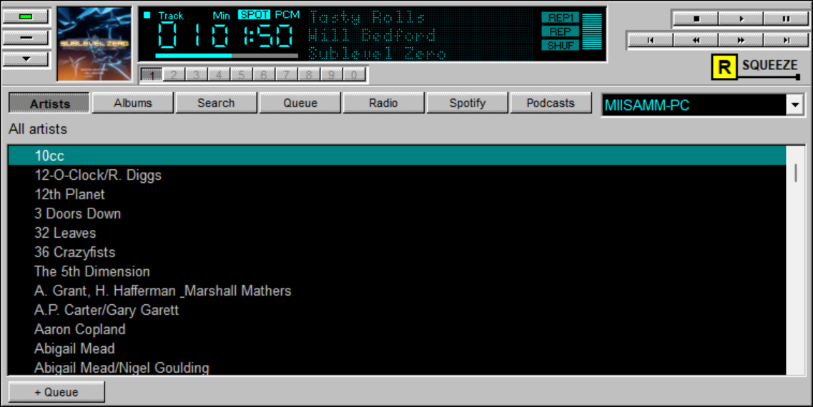
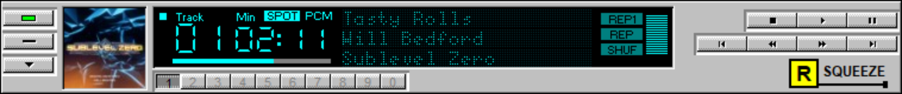
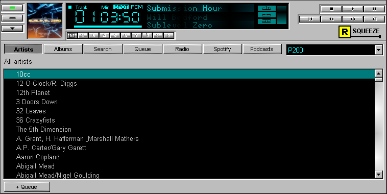
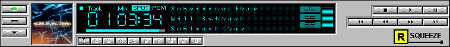

# RetroSqueeze

A small Lyrion Music Server (LMS, formerly Logitech Media Server / Squeezebox Server)
**controller and player** for Windows, from **Windows 98 up to Windows 11** - the
same 137 KB EXE, no installer, no runtime, no .NET.

It does two things at once:

- **Remote control** for any player on your LMS: now playing with cover art, a dot-matrix
  LCD, transport, volume, repeat/shuffle, seek, the queue, and browsing your library
  (artists, albums, search), internet radio, podcasts and Spotify.
- **A Squeezebox player itself**: the PC shows up in LMS as a player, like a Squeezebox or
  squeezelite. Play to it from RetroSqueeze, from the LMS web UI or from phone apps, and
  sync it with other players.

The look is a nod to the Sound Blaster MIDI player of the mid 90s: 80 pixels high, no title
bar, silver deck, black LCD. Click the bar key on the left to fold the browser away.



Folded to just the deck:



The same EXE on a Pentium 200 MMX with Windows 98 SE, using the original key bitmaps
from an installed Creative Sound Blaster software (optional, see below):





## Requirements

- A Lyrion Music Server on your network (tested with 9.1). Its CLI (TCP 9090) is on by default.
- Windows. Tested on Windows 98 SE (Pentium 200 MMX), Windows 2000 and Windows 11; it only
  needs Winsock 1.1, so Windows 95, ME, NT4, XP, 7 and 10 should work too (reports welcome).
- A sound card with a waveOut driver.

## Install

1. Download `RETROSQ.EXE` from the Releases page and put it in a folder of its own
   (it writes `RETROSQ.INI` next to itself).
2. Start it. On the first start it looks for the server on the local network (the same
   UDP broadcast Squeezeboxes use). If your server is on another subnet/VLAN, it asks for
   the address instead.
3. A new player named after the computer appears in LMS and is selected.

**Copying to another PC: copy only the EXE, never the INI.** The INI holds this PC's
own player MAC address; two PCs with the same INI fight over one LMS player.

## Spotify

RetroSqueeze plays Spotify through the LMS **Spotty** plugin (install it from the LMS plugin
settings; needs Spotify Premium): the **Spotify tab** browses and searches Spotify inside
RetroSqueeze, no Spotify app needed anywhere.

Without Spotty on the server the Spotify tab is simply not shown. The same goes for the
Podcasts tab and the LMS Podcasts plugin. RetroSqueeze checks this at start and again
every 15 seconds, so installing a plugin makes the tab appear without a restart.

## Original Creative look (optional)

Out of the box RetroSqueeze draws its own keys in the style of the old Creative player.
If you own Creative's Sound Blaster software (AWE32/AWE64/SB16-era Windows 95/98 CD or
install), you can use the original key bitmaps: copy **`MIDRES32.DLL`** from it
(usually `C:\Program Files\Creative\CTSND\PROGRAM\`) into the RetroSqueeze folder.
RetroSqueeze looks for it next to the EXE, then at `skin=` in the INI, then at that standard
path, so on a PC with the Creative software installed it is picked up automatically.

The DLL is Creative's copyrighted software and is **not** included or distributed here -
please don't open issues or pull requests that add it.

## Settings (`RETROSQ.INI`)

| Key | Meaning |
|---|---|
| `lms=host:9090` | Server and CLI port. Delete the line to search for the server again. |
| `web=9009` | LMS web port (cover art). |
| `player=` | MAC of the player last controlled. |
| `localplayer=1` | `0` = remote control only, the PC is not a player. |
| `playername=` | Name of this PC's player in LMS (default: computer name). |
| `playermac=` | This PC's player MAC, made on the first start. Unique per PC. |
| `compact=1` | Start with the browser folded away. |
| `remain=1` | Time display counts down (click the time to toggle). |
| `skin=` | Path to a `MIDRES32.DLL` elsewhere (see *Original Creative look*). |

## How it works

- **Controller**: the LMS CLI on TCP 9090 (plain text, no JSON parser needed): one
  connection polls the selected player's status once a second, another runs browse
  requests and commands. Cover art comes from the LMS web port as small baseline JPEGs.
- **Player** (`slimplay.c`): the SlimProto protocol on TCP 3483, modelled on squeezelite.
  The player advertises PCM and MP3. LMS transcodes FLAC/ALAC/AAC/Ogg to raw PCM on the
  server, so the PC does no decoding at all; MP3 is decoded locally with minimp3 (LMS has
  no mp3-to-pcm rule). Output is plain waveOut, 16-bit 44.1 kHz. It also does gapless
  track changes, ICY radio metadata, and the server's volume curve.
- Imports only `KERNEL32`, `USER32`, `GDI32`, `WSOCK32` and `WINMM`, which is why one EXE
  runs everywhere from Windows 98 to Windows 11.

## Building

Needs [Open Watcom V2](https://github.com/open-watcom/open-watcom-v2) (Linux or Windows host).

```sh
export WATCOM=/path/to/openwatcom
export PATH=$WATCOM/binl64:$WATCOM/binl:$PATH      # Windows host: binnt64/binnt
export INCLUDE=$WATCOM/h:$WATCOM/h/nt
wmake -h
```

`make slimplay-test` (gcc, Linux) builds the player core alone, with a silent real-time output,
for testing against a server: `./slimplay-test <server> <name> 02:52:53:00:00:01`
(`SLIMPLAY_DUMP=file` writes the PCM, `SLIMPLAY_DEBUG=1` traces the protocol).
Remove the test player from LMS afterwards.

## Credits and licenses

RetroSqueeze is Copyright (C) 2026 Sandro Miisamm, licensed under the **GNU GPL v3 or later** (see `LICENSE`).

Designed, tested and directed by Sandro Miisamm on real hardware (Pentium 200 MMX / Windows 98 SE
up to Windows 11); the code was written together with **Claude** (Anthropic's AI model, via
Claude Code) - protocol work, Win32/Watcom code, the dot-matrix LCD and the drawn keys.

Third-party code included:

- [stb_image](https://github.com/nothings/stb) v2.30 by Sean Barrett - public domain / MIT (JPEG covers)
- [minimp3](https://github.com/lieff/minimp3) by lieff - CC0 (`LICENSE.minimp3`)
- 5x8 dot-matrix font: X11 misc-fixed 5x8 (public domain), taken from SDL_gfx

Protocol behaviour follows [squeezelite](https://github.com/ralph-irving/squeezelite) and
the LMS CLI documentation.

Not affiliated with Logitech, the Lyrion project, Spotify or Creative Technology.
All trademarks belong to their owners. No Creative software or artwork is included.
